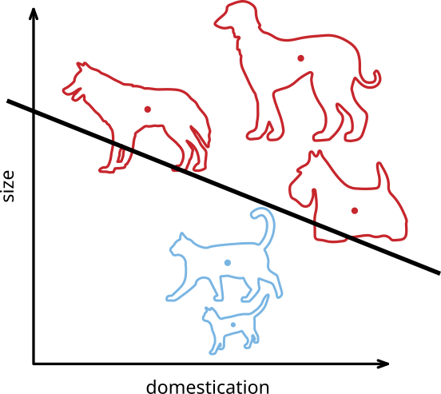
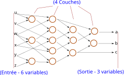
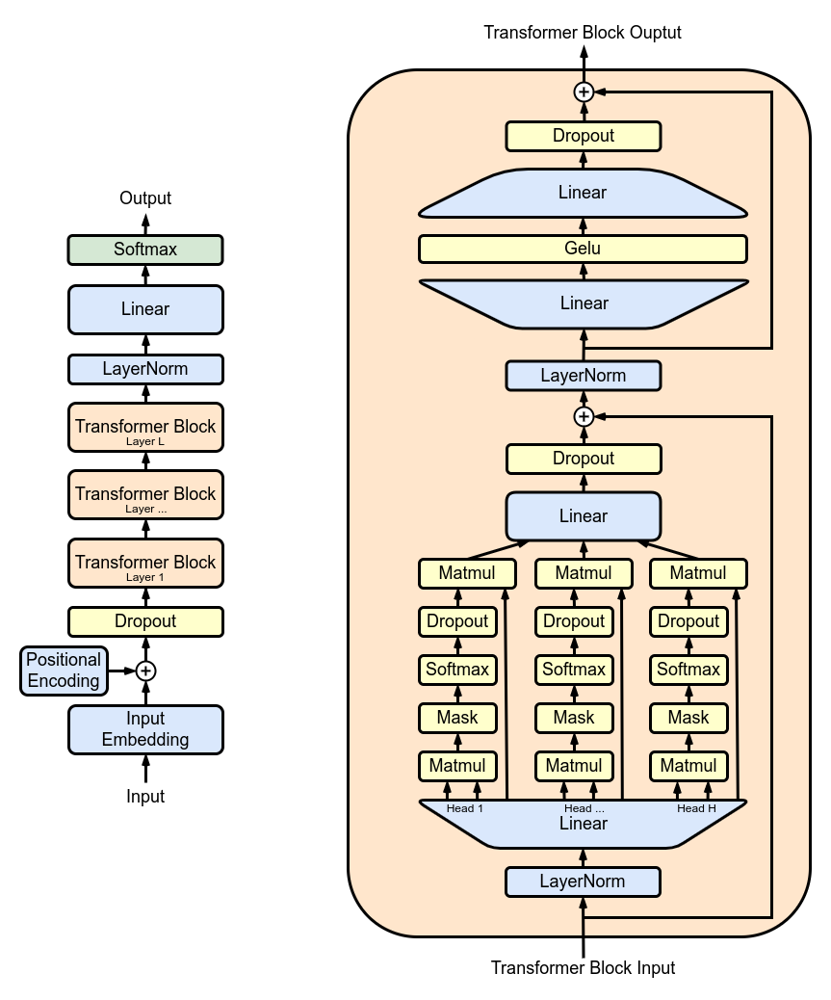

<!-- link rel="stylesheet" href="../style/imt.css" -->

# Decision Under<br />Uncertainty

### LLM Based AI

<br />

**Guillaume.Lozenguez**
[@imt-nord-europe.fr](mailto:guillaume.lozenguez@imt-nord-europe.fr)


---
<!-- --------------------------------------------------------------- -->


- **Au début était le LLM**
- **Agentic AI**
- **Boucle de raisonnement**

---
<!-- --------------------------------------------------------------- -->

## Au cœur des LLMs - les réseaux de neurones.

### Le perceptron:

<div class="line">
<div class="one2">


$$\mathit{si:}  \quad \left( p_1 \cdot x + p_2 \cdot y > b \right)$$

Les paramètres:

- les poids: $p_1, p_2$ 
- un seuil: $b$

</div>
<div class="one2">



</div>
</div>

> Le grand problème des data-sciences: Classifier

---
<!-- --------------------------------------------------------------- -->

## Au cœur des LLMs - les réseaux de neurones.


### Le perceptron:

<div class="line">
<div class="one2">


</div>
<div class="one2">


</div>
</div>

> 1 neurone : min. 2 poids et un hyperparamètre: la fonction d'activation


---
<!-- --------------------------------------------------------------- -->

## Au cœur des LLMs - les réseaux de neurones.

<br />

### Un réseaux de neurones




**La Qualité de la prédiction Dépend:** 

<div class="line">
<div class="one2">

- Données d'entraînement
- Taille

</div>
<div class="one2">

- Structuration en couche
- Algorithme de propagation

</div>
</div>

---
<!-- --------------------------------------------------------------- -->

## Au cœur des LLMs - les réseaux de neurones.


### À l'exécution (inférences):

**Le nombre de neurones conditionnent :**

- le nombre de poids (taille)
- le nombre de calculs (min. 1 op. par neurone)

<br />

**La structuration du problème permet l'usage de carte graphique :** 

- Parallélisation des calculs par couche
- Calculs sur valeurs à virgule flottante

---
<!-- --------------------------------------------------------------- -->

## Au cœur des LLMs - les réseaux de neurones.

### L'objectif:

<br />

**Mettre en place un mécanisme d'attention : Transformer**

_i.e:_ Pouvoir intégrer des contextes énormes.

<br />

**Prédire le prochain "morceau" de phrase :** _token_

"il <em>|</em>dit <em>|</em>non <em>|</em> av<em>|</em>ec <em>|</em>la <em>|</em>tê<em>|</em>te <em>|</em>mais <em>|</em>il <em>|</em>dit <em>|</em>oui <em>|</em>av<em>|</em>ec <em>|</em>le <em>|</em>?.."

<br />

**Itérer autant de fois que nécessaire.**


---
<!-- --------------------------------------------------------------- -->

## Au cœur des LLMs - les réseaux de neurones.

<div class="line">
<div class="one2">

### Chat GPT-3 (nov. 2022):

- **Objectif:** (re)produire du texte
- _175 milliards_ de paramètres
(avec une augmentation itérative)
- _Les données:_ le web (80%), des livres (16%) et Wikipédia (3%)
- **Résultat:** une réponse par association de mots (le + disant)
bien construite

</div>
<div class="one2">



</div>
</div>


---
<!-- --------------------------------------------------------------- -->

## Galaxie Open-Source des LLMs

### Open-Source Software and Open-Weight Model.

- **Soft:** Ollama - OpenCode - OpenClaw - Hermes ...
- **Models:**
    - google `gemma` - meta `llama`
    - chinois : `deepseek`, `qwen`
    - huggingface : hub de l'open source et open model.

---
<!-- --------------------------------------------------------------- -->

## Galaxie Open-Source des LLMs - Ollama

- Un manager de LLM et de harnais (dans le terminale)
- Un API python.

<br />


Commande     |       Usage  
-------------|-------------------------
ollama run <model>  | Lance un model en mode chat (le charge au besoin).
ollama ls           | Liste les modèles sur la machine.
ollama ps           | Liste les modèle en cours d'exécution.
stop / rm / ...     | Décharge, Supprime un  model et plus encore

---
<!-- --------------------------------------------------------------- -->


- Au début était le LLM
- **Agentic AI**
- Boucle de raisonnement

---
<!-- --------------------------------------------------------------- -->

## Agentic AI - ou - Les LLMs qui agissent

### Notion d'Agent vs IA Agentique

- An **AI agent** is an artificial intelligence program that can make decisions, pursue goals, and take actions independent of humans (Wikipedia, 2026).
- L'**IA agentique** réfère davantage à un programme basée sur les LLM et capable d'agir sur le systéme.

### Concrétement l'IA agentique

Écris dans des fichiers - exécute des commandes dans un terminal

<br />

> Et le terminal ouvre la porte à toute les fenêtres...


---
<!-- --------------------------------------------------------------- -->

## Agentic AI avec Ollama

### Connecter un LLM

```python
import ollama

gen= ollama.generate(
    model='cloud-medium',
    prompt="Qui a écri le Cancre ?"
)

print(gen.response)
```

---
<!-- --------------------------------------------------------------- -->

## Agentic AI avec Ollama

### Prompt engineering

- Générer une réponses adéquate
- Dans un format attendu, facilitant l'extraction d'information.

<br />
<br />

**Exemple :** Trouver une commande effective à exécuter.


---
<!-- --------------------------------------------------------------- -->

## Agentic AI avec Ollama

<br />

### Prompt engineering - Le contexte

- _prompt_: Le prompt, inclut les éléments utiles pour répondre à une requête.
- _system_: Instructions permettant de donner un cadre aux réponses produites : type de réponses attendues, rôle etc. (i.e. des constantes pour plusieurs prompts).

**Dans le code :**

```python 
gen= ollama.generate(
    model= 'gemma4:cloud',
    system= "Dialogue entre expert systéme, réponses courtes.",
    prompt= request
)
```

**En environnement run:** `/show system`, `/set system`, 


---
<!-- --------------------------------------------------------------- -->

## Agentic AI avec Ollama

### Prompt engineering - Des paramètres aux modèles

- **Jouer avec le hasard lié à la génération:**
    - _temperature_: Créativité entre 0 et 1
    - _top_p_: borne sur les probabilités des tokens gardés
    - _top_k_: nombre de token gardé dans le choix aléatoire
- Contrôler la taille des requêtes / réponse
    - _num_ctx_: Taille de la fenêtre (input + output tokens).
    - _num_predict_: nombre max. de tokens générés.

---
<!-- --------------------------------------------------------------- -->

## Agentic AI avec Ollama

### Interpréter la réponse.

**La difficulté :** <br />Extraitre l'information dans la réponses (i.e. la commande à exécuter).

1. Utiliser le prompt pour circonscrire la réponse au strict minimun.
2. Parser. 

**En Python :**

- Opération sur les strings: `find`, `split`, ...
- Au dela: les expressions régulières basées sur des patterns

```python
# Chercher un nombre entier ou décimal (avec . ou ,)
match = re.search(r'-?\d+(?:[.,]\d+)?', texte)
```

---
<!-- --------------------------------------------------------------- -->

## Agentic AI - harnais

<br />

**Élément de vocabulaire :**

- An **agent harness**, also known as **agent scaffolding**, is the software infrastructure surrounding a large language model (LLM) that enables it to operate as an **AI agent**.

<br />

**Agentic AI - c'est aussi**

- Infrastructure réseaux (interconnecter un LLM, son harnais, potentiellement des outils...)
- Couche protocolaire d'interconnections :
    * **RAG** base de connaissance ; **skill** modules d'harnais ; **MCP** / **A2A** protocoles de description et d'interconnection d'agent

---
<!-- --------------------------------------------------------------- -->


- Au début était le LLM
- Agentic AI
- **Boucle de raisonnement**


---
<!-- --------------------------------------------------------------- -->

## Boucle de raisonnement - Limites des LLMs

<br />

#### The core of large models is **predicting the next word** <br />by learning statistical patterns from massive amounts of text data. <br />It outputs fluent answers that appear logical, but it does **not truly understand concepts** such as "gravity" or "apple";<br /> it only masters the co-occurrence patterns between words

<br />
(deepseek 2026 : "What is Thinking in Artificial Intelligence ?")

<br />
<br />
<br />

> **La force:** A massive amounts of text data :
> $\rightarrow$ un contexte potentiellement énorme

---
<!-- --------------------------------------------------------------- -->

## Boucle de raisonnement - chain-of-thought


<br />
<br />

#### In order to make outputs appear more "intelligent," technologies such as chain-of-thought have been developed. They guide models to **write out step-by-step reasoning** processes **before giving an answer**.

<br />

(deepseek 2026 : "What is Thinking in Artificial Intelligence ?")

<br />
<br />
<br />

> **Comprendre:** Chercher à enrichir le contexte d'élément factuel<br />avant de générer la réponse à proprement parler.

---
<!-- --------------------------------------------------------------- -->

## Boucle de raisonnement - Simuler un processus de raisonnement

**Article fondateur:** Wei, J., Wang, X., Schuurmans, D., Bosma, M., Ichter, B., Xia, F., Chi, E., Le, Q., & Zhou, D. _Chain-of-thought prompting elicits reasoning in large language models._ Advances in Neural Information Processing Systems<br /> (NeurIPS 2022)

<br />
<br />

- Enrichir le prompt de raisonnement étape par étape <br /> *$\rightarrow$* Améliore la réponse générée

---
<!-- --------------------------------------------------------------- -->

## Boucle de raisonnement - Solution basique

_INPUT:_ une requête - un connecteur sur un LLM

1. Demander au LLM de lister les étape pour résoudre la requête<br />(en précisant bien de ne pas y répondre directement).
2. Pour chaque étape de la liste : 
    - demander au LLM de travailler dessus
    - enrichir le contexte du résultat
3. demander au LLM de concaténer une réponse

_OUTPUT:_ la réponce

---
<!-- --------------------------------------------------------------- -->

## Boucle de raisonnement - Pour l'exécuteur de commande

_INPUT:_ une requête - un connecteur sur un LLM

1. Demander au LLM de lister les commandes possible répondant à la requête.
2. Demander au LLM de sélectionner la commande la  plus pertinente relative à la requête
3. Éxécuter la commande.

_OUTPUT:_ néan


---
<!-- --------------------------------------------------------------- -->

<br />
<br />


- **Au début était le LLM**
- **Agentic AI**
- **Boucle de raisonnement**

<br />

> Exercice: appliquer au 421


